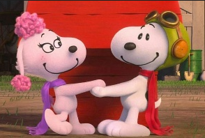
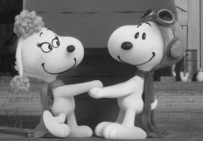
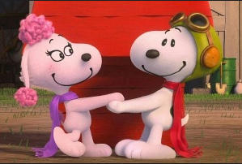
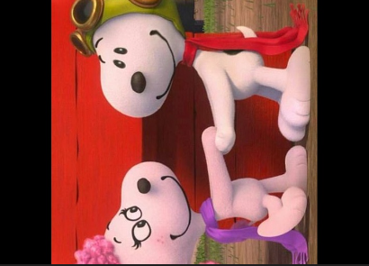
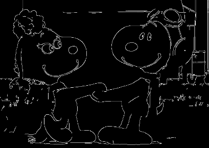
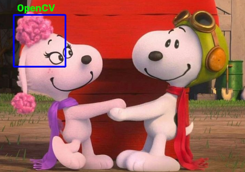
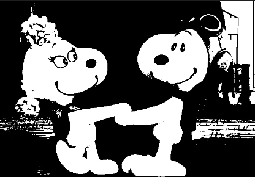
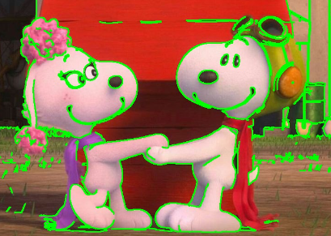

# 2. Reading and Displaying Images 0200

# 3. Converting Between Color Spaces

# 4. Resizing an Image

# 5.1 Code Example: Rotate the image by 90 degrees

# 6. Blurring an Image

# 7. Edge Detection Using Canny Algorithm

# 8. Drawing Shapes and Adding Text

# 9. Thresholding

# 10. Contours Detection
